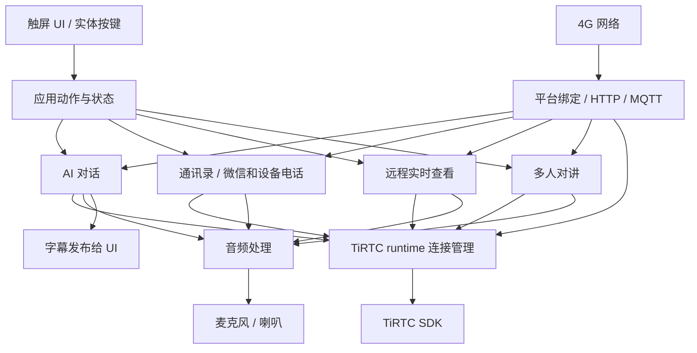

# 代码与流程详解

本篇介绍示例如何把 **UI、平台业务、TiRTC 和板级驱动** 组合起来。开发自己的产品时，可以沿用网络与通话流程，替换界面和硬件适配。

[项目首页](../README.md) · [文档目录](README.md) · [上一篇：设备操作](当前设备操作.md) · [下一篇：TiRTC 接入](TiRTC接口调用与模块流程.md)

**阅读层次：** 第 1～6 节看结构，第 7～11 节看媒体和修改边界；后半篇用一次真实动作串起代码，再深入状态、并发、性能和资源。

[一次点击的代码路径](#code-walkthrough) · [状态与任务](#states-tasks) · [并发保护](#concurrency) · [统计与性能](#performance) · [资源预算](#memory-budget) · [扩展方法](#extension)

## 1. 先看整体分层



- **UI** 收集用户操作，显示业务状态。
- **平台业务** 完成身份、联系人、呼叫邀请和房间协商。
- **TiRTC runtime** 管理 SDK、连接和媒体会话的使用权。
- **音频模块** 负责采集、编解码和播放。
- **板级适配** 把这些能力落到实际芯片、音频器件和屏幕。

这样新增页面不需要重写连接协议，换一块板子也可以优先替换硬件接口。

## 2. 建议按这个顺序读代码

| 顺序 | 入口 | 重点看什么 |
| --- | --- | --- |
| 1 | [user_main.c](../user_main.c) | 启动服务，接收 UI/按键动作，更新偏好 |
| 2 | [ui/tirtc_ui.h](../ui/tirtc_ui.h)、[ui/tirtc_ui.c](../ui/tirtc_ui.c) | 业务动作、状态快照和页面切换 |
| 3 | [runtime/tirtc_runtime.h](../runtime/tirtc_runtime.h) | 连接、发送、订阅与会话管理接口 |
| 4 | [calls/tirtc_calls.c](../calls/tirtc_calls.c) | 一次微信/设备电话从发起到结束 |
| 5 | [ai/tirtc_ai.c](../ai/tirtc_ai.c)、[remote/tirtc_remote.c](../remote/tirtc_remote.c) | AI 和被动实时查看如何复用同一套媒体能力 |
| 6 | [media/audio_device.c](../media/audio_device.c) | 录音和播放如何接入板级硬件 |
| 7 | [group/tirtc_group.c](../group/tirtc_group.c) | 房间分配、默认收听、PTT 与电话交接 |

不必一开始就通读底包和所有 SDK 头文件。先沿一条完整业务路径读懂，再进入需要修改的模块。

## 3. 目录职责

| 目录 | 作用 | 常见改动 |
| --- | --- | --- |
| `ui / port` | 页面、LVGL、触摸、LCD | 页面设计、屏幕与触摸适配 |
| `network` | SIM、4G 注册、移动数据、信号、时间 | 网络状态和新模组接口 |
| `platform` | 服务发现、绑定、鉴权、HTTP、MQTT | 平台入口和业务协议 |
| `contacts / calls` | 联系人同步、主被叫、接听与挂断 | 联系人展示、呼叫产品策略 |
| `ai` | AI 会话、字幕、工具调用 | AI 指令与工具业务 |
| `remote` | 平台发起的实时查看和对讲 | 被动接入策略 |
| `group` | 多人房间关系、连接、成员及按住讲话 | 房间协议与媒体抢占 |
| `media` | 音频硬件、Opus / G.711 | 更换采集播放接口、调整媒体参数 |
| `preferences / keys` | 设置保存、音量按键 | 新配置字段、按键定义 |
| `storage / resource_store` | 外置文件系统、UI 资源 | 字体背景、新文件资源 |
| `resources / status` | 资源与运行状态快照 | 展示实际设备数据 |
| `runtime / sdk` | 受管连接与 TiRTC 库 | SDK 适配与成套版本升级 |
| `board_compat` | 产品启动、屏幕和链接适配；底包使用公共 SDK | 经过核对后的板级迁移 |

应用配置在 [config](../config)，源文件与链接选择在 [tirtc_app.mk](../tirtc_app.mk)。新增业务尽量留在本应用目录。

## 4. 从开机到工作

```text
读取保存的音频设置
→ 启动屏幕、触摸和按键
→ 启动资源、4G、平台及各业务服务
→ 后台完成联网、绑定和 TiRTC 就绪
→ 用户操作或平台事件触发一次业务
→ 业务结束，回收本次媒体资源，继续待机
```

UI 先出现，联网在后台执行。主循环每 20 ms 扫描按键，每 500 ms 检查偏好保存，一般状态约 5 秒更新，网络约 2 秒采样；音频按媒体任务的节奏处理，不跟着资源页的刷新周期运行。

服务启动入口支持重复检查，失败可以稍后重试。任务创建成功、平台就绪、连接成功、对端接听、实际出图是不同状态。

## 5. UI 怎样连接业务

触摸事件通过 `app_ui_action()` 分发：例如开始 AI、刷新联系人、语音呼叫、修改音量。事件处理只做短判断和入队，HTTP、录音、文件写入不在触摸回调里等待。

后台通过 `tirtc_ui_publish_*()` 发布状态快照；UI 任务统一操作 LVGL。这样网络线程不会在绘制过程中修改控件，也避免界面滚动时阻塞媒体回调。

增加一个功能通常分三步：

1. 定义 UI 动作和需要显示的状态。
2. 在业务模块执行操作，管理成功、失败、取消和超时。
3. 发布快照，由 UI 更新显示。

不要仅让按钮回调返回成功，就把对应功能标记为已连接。多人对讲通过独立 `group` 后台处理，只有 TiRTC 的 `join_room` 确认成功后才允许讲话；成员通过独立 `publish_room` 邮箱进入 UI。

## 6. 多种业务怎样共用音频

当前 TiRTC 最大连接数为 1，音频硬件也是共享资源：

```text
空闲 → AI / 微信电话 / 设备电话 / LIVE / GROUP 中的一种 → 清理 → 空闲
```

runtime 使用 `owner` 标记谁在使用连接，使用 `generation` 标记这是第几次会话。旧回调即使晚到，也不能操作新会话。

例如 AI 语音要求呼叫微信时：

```text
AI收到工具命令
→ 刷新联系人并确认唯一目标
→ 回复工具受理结果
→ 排队现有 calls 呼叫
→ AI停止并归还音频、连接
→ calls取得使用权，开始语音电话
```

电话、AI 和 LIVE 的停止流程都要先禁止新数据进入，再等待采集、DMA、播放及连接退出，最后释放资源。直接清空状态变量，无法保证硬件真正停止。

## 7. 音频数据怎样流动

### 7.1 音频

AI 对话与设备互呼采用 16 kHz 单声道 Opus。设备互呼也接收 8/16 kHz G.711 A-law，微信、多人对讲及 LIVE 保留 8 kHz G.711 A-law。以下是 G.711 路径：

```text
麦克风 → 16kHz单声道PCM16 → 相邻样本取平均降至8kHz → A-law编码 → TiRTC
TiRTC的8kHz A-law → 解码 → 每样本复制两次形成16kHz PCM16 → ES8311与喇叭
```

本机每 20 ms 为 320 个采样、640 字节 PCM16；8 kHz 网络上行取平均后为 160 个样本，编码为 160 字节 A-law。LIVE 下行同时接受 8/16 kHz A-law，8 kHz 展开为 16 kHz PCM，16 kHz 直接解码后播放。

AI 和设备互呼上行将 320 个 PCM 样本编码为一包 Opus（20 ms，目标 24 kbit/s，复杂度 3）。下行按完整包解码，单包最长 120 ms。默认 AEC 的 AI 压缩队列上限为 256 包、128 KiB 或 81,920 个 PCM 样本（任一上限先到即满，按 16 kHz 为 5120 ms），预缓冲目标为 80 ms，等待上限为 120 ms。设备互呼下行队列为 32 槽，自适应预缓冲目标从 100 ms 起，在约 60～240 ms 内调整。硬件队列暂满时保留解码结果，下次继续提交。

AI 的媒体任务先服务播放，回复期间暂停麦克风上传，播完才重新采集。默认 AEC 构建中，KEY2 单按清除当前回复的待播软件队列，等已提交的硬件音频播完再恢复收音，连按两次走正常退出流程。开启 AEC 时，设备互呼由独立任务持续采集编码，控制任务负责下行播放，`call_tx` 负责发送。关闭 AEC 时，设备互呼由控制任务依次播放和录音。微信、LIVE 和 Room 沿用各自媒体协议。Room 按 PTT 打开采集门，发送由独立的 room_tx 任务处理。各路径保留业务预缓冲；默认 AEC 由 SDK 流回调提供 PCM，独立 AEC 工作线程负责播放和停流，旧的连接/段首静音预热接口返回额外时长 0，不插入 1280 ms 前导。关闭 AEC 时保留原预热流程。音量及开关经统一音频适配生效。

电话/LIVE 的 TX 任务直到发送返回值、计数和日志处理完成才撤销在途标记；这段时间结束或切换会话要等待，避免旧发送结果写入新会话。线程和队列创建失败后允许干净重试，不能删除已有工作线程仍在使用的队列。

多人对讲的媒体由独立 Room 任务处理，收听时不调用录音。下行协商固定为 `g711a / 8000 / mono`，将连续 A-law 数据跨网络包拼接，最多取 160 个编码样本，解码后每个样本复制两次，每次提交最多 320 个 16 kHz PCM16 样本。奇数尾部保留最后一个字节等待后续数据；孤立尾字节约 80 ms 后仍未接上，就展开为两个 PCM 样本播放，不补零。语音开始时最多等待 100 ms（或收到 480 字节，等效 60 ms），随后批量补充播放队列，按采样点累计时间，将已提交的预计待播时长控制在 240 ms 内；关闭 AEC 时，连接静音预热单独计算，只有预计尾时已过且播放完成后才重新预热。默认 AEC 不插入旧预热静音；队列暂满时保留原块并继续服务上行，之后按顺序重试。

各业务遵循设置页保存的音量、麦克风增益和开关。扬声器 L1～L10 使用与 Lite 对齐的 30～60 曲线，L0 静音。出厂默认 L8，设备互呼麦克风增益/数字音量为 10/196，其他语音业务为 9/190。曲线见 [音频适配](../media/README.md)，Room 业务与协议见 [多人对讲](多人对讲.md)。

<a id="group-flow"></a>
### 7.2 多人对讲的完整工作流

Room 由 [group/tirtc_group.c](../group/tirtc_group.c) 的 HTTP 任务和房间任务共同驱动。启动时先注册正式 MQTT handler 和 TiRTC feature listener。`room_assignment_changed` 命令只触发 assignment 重查：校验版本，忽略比本地旧的提示及已过期的数值型 `expires_at`，不凭 MQTT 消息直接建连。进入房间页可复用同一服务上下文中 30 秒内的分配结果和同一版本的在途查询。网络恢复、分配变更提示、手动刷新及前台约 60 秒的周期同步会重新查询，后台查询不占用媒体。

assignment 为有效 joined 关系、房间页在前台且其他媒体空闲时，Room 才申请 RTC 与音频使用权，取得 connect-token 并校验租约，然后执行：

```text
WHIP 连接成功 → 订阅 stream 1 → 发送 0x2200 JSON-RPC join_room
→ 校验匹配 id 的 ACK、session_id 和音频描述 → 打开接收门、默认收听
→ 请求 get_room_snapshot → presence joined 保活 → 有效 PTT 时发送麦克风
```

订阅早于 ACK，但 ACK 前不会接受音频。HTTP 使用本机生成的业务 `session_id`，ACK 返回另一个媒体会话 ID；两者不要求相等。ACK 提供 `room_id` 时才校验范围，后续通知必须有匹配的 `params.room_id`，首次合法 wire ID 形式固定后不再切换。

成员快照和 participant 事件经有界命令队列进入房间任务，再由 `publish_room` 邮箱交给 UI。快照约每 10 秒请求一次；加入、离开事件会提前触发重查，说话事件更新当前成员标记。PTT 动作同时匹配 UI 房间代次和房间号，约每 200 ms 续期，后端租约约 750 ms，并发送 `set_mic_state`。松开、续期超时、关闭麦克风或媒体退出都会停麦；重新加入和恢复不会自动继续讲话。按住期间仍处理下行，客户端没有独占发言权机制。

清理顺序是关闭采集、接收和命令门，尽力发送停麦及 `leave_room`，停止音频，等待仍在进行的回调、WHIP 提交和音频发送退出，先归还音频租约，再断开 TiRTC 并释放 RTC session。各层分别校验身份上下文、assignment 版本、会话代次和页面意图；成功的 create/join/leave 结果可更新同一身份下的新分配，但过时的页面意图不会强制跳页。

电话先登记自身会话意图，再调用 `tirtc_group_suspend()`，等待 Room 归还资源后申请连接。进入通话页前若在 ROOM 或 ROOM_FORM，呼入/呼出结束后 UI 返回房间页并重新同步；其他页面沿用通话结果页。离页与媒体清理保留服务端分配关系；presence 的 `left/suspended/connect_failed` 和命令 `leave_room` 不等于业务退房，显式退出才提交 HTTP `/device/leave`。

#### Room 资源边界

- 房间命令最大 16 KiB；命令队列 2 槽。
- 下行接收队列 16 槽，每槽最多 640 字节，累计最多 2560 字节，过期音频约 400 ms 后丢弃。上行发送队列 8 槽，超过 200 ms 的帧丢弃。
- HTTP 响应上限 4 KiB；HTTP 单次超时约 10 s。
- WHIP 连接等待 20 s、join ACK 等待 8 s、资源等待 30 s；失败按类型退避或等待用户刷新，不在 UI 线程执行网络和 JSON 解析。
- 一次只有一个媒体 owner；Room 与 AI、电话、实时查看通过 runtime lease 交接。

详见 [多人对讲](多人对讲.md) 的接口表、错误码和诊断字段。

## 8. 网络、联系人和设置

| 事项 | 当前处理 |
| --- | --- |
| 4G | 使用 CID 1，自动检测注册和移动数据，断线后恢复 |
| 信号条 | 综合 RSRP、RSRQ、SNR；过期样本不继续显示旧满格 |
| 平台 | 服务发现、首次绑定、正式 token、正式 MQTT |
| 通讯录 | 正常约 30 秒刷新，最多 12 条；失败退避，旧数据不能冒充新同步 |
| HTTP/MQTT | 校验身份和路由上下文，避免迟到响应作用到新会话 |
| 音频设置 | 音量、增益、两个开关使用内部 NVM 双槽保存 |
| 连续调节 | 先更新 RAM，稳定约 1 秒后合并写入并读回验证 |

更换平台或对接呼叫协议的步骤见 [TiRTC 接入篇](TiRTC接口调用与模块流程.md)。

## 9. Flash 和内存怎样分配

程序、文件与运行内存分开管理：

| 资源 | 当前用途 |
| --- | --- |
| 应用程序区 | 当前 F6D_D 链接配额 1,112 KiB；实际占用看构建结果 |
| 内部 NVM | 正式身份、音量与开关 |
| 外置 4 MiB SPI Flash | 字体、背景及应用文件 |
| 系统堆 | 网络、任务和音频运行缓冲 |
| LVGL 内存池 | UI 对象和绘制资源 |

外置 Flash 可以存资源文件，不能直接当新增程序执行区或实时帧 RAM。新业务通过 [storage/tirtc_storage.h](../storage/tirtc_storage.h) 读写文件；现成示例在 [storage/examples](../storage/examples)。

当前外置存储保护已有数据，不把挂载失败直接当成空盘格式化。字体缓存及资源安装方式见 [resource_store/README.md](../resource_store/README.md)。

## 10. 开发时看哪些日志

常态保留启动和必要错误日志，音频会话与音量状态通过设备界面查看。详细诊断可临时启用 [tirtc_log.h](../tirtc_log.h) 的 `TIRTC_ENABLE_DEBUG_LOG` 并重编译。

| 日志 | 回答的问题 |
| --- | --- |
| `network / NET41` | SIM、注册、移动数据和信号是否正常 |
| `BIND-HTTP / FORMAL-MQTT` | 平台鉴权、订阅、请求是否成功 |
| `TIRTC-ADAPTER / CALL22 / LIVE42` | 本次连接属于谁，何时接通和结束 |
| `AI-CALL` | AI 是否真的下发工具指令、是否转交电话模块 |
| `GUI35` | 界面刷新异常排查 |
| `AUDIO42` | 音频准备、收发与播放错误 |
| `ROOM` | 房间连接、成员和按住讲话状态及错误 |

分析时使用同一会话、同一时间窗口。分别记录 SDK 提交、远端接收与实际出声。Flash/RAM 足够也不能单独证明卡顿一定来自 CPU。

## 11. 改成自己的产品

| 要改什么 | 优先修改 |
| --- | --- |
| 界面和交互 | `ui`、动作分发，保持后台业务接口 |
| 屏幕/触摸 | `port` 及本产品板级配置 |
| 麦克风/喇叭 | `media/audio_device` |
| 平台和联系人规则 | `platform / contacts / calls` |
| 新的 AI 工具 | `ai` 的解析与业务分发 |
| 自有资源或配置 | `resource_store / storage / preferences` |

公共 SDK 尽量保持一致；本板专用依赖集中在 `board_compat`，由应用 Makefile 选择。底包与库的哈希检查用于保护 ABI 匹配，升级时重新核对，不直接删掉检查。

当前两个产品已分别放在 `TiRTC-EC718PM-Lite` 和 `TiRTC-EC718PM-Pro`。各产品目录的构建脚本选择各自配置、源文件、TiRTC 库和独立输出目录；一个固件只链接一套应用入口与 SDK 生命周期，业务不跨产品引用。构建与依赖边界见 [双产品说明](README.md#two-products)。

<a id="code-walkthrough"></a>
## 12. 跟着一次“语音呼叫”读代码

理解这条路径后，再看 AI 和远程对讲，会发现它们复用了很多相同模块。

### 12.1 从触摸事件到业务请求

| 步骤 | 源码入口 | 该层做什么 |
| --- | --- | --- |
| 显示联系人 | `ui/tirtc_ui.c: render_contacts / fill_contacts` | 从已发布的 UI 快照绘制列表 |
| 选中联系人 | `contact_cb / render_contact_detail` | 记住联系人 ID 和微信/设备类别，展示详情 |
| 点语音呼叫 | `dial_cb` | 重新找当前联系人、检查可用性，提交 `TIRTC_ACTION_CALL_AUDIO` |
| 动作分发 | `user_main.c: app_ui_action` | 把动作交给对应业务模块 |
| 通话受理 | `calls/tirtc_calls.c: tirtc_calls_action` | 复制必要信息、检查忙碌和状态，排队本次请求 |
| 执行呼叫 | `step / new_call / request_dial` | 申请使用权，按微信或设备协议发起平台请求 |

联系人用稳定的 ID 与类别识别，不能只记“列表第 2 行”。列表刷新或排序变化后，第 2 行可能已是另一个人。

### 12.2 平台同意请求，还没有开始通话

电话模块把 HTTP 作业交给独立任务。控制任务处理结果、通知与回调，继续走建连、等待接听确认、启动媒体。

这几个概念要分开：

```text
UI动作受理：按钮请求已进入业务
平台请求成功：平台收到并处理了邀请
媒体连接建立：可以通过TiRTC传数据
通话激活：本次连接与业务接听条件均满足
实际出声：采集、传输、解码和播放链路已经工作
```

因此 UI 不应在 HTTP 返回 200 的瞬间直接显示“对方已接听”。当前 calls 的 `C_CONFIRM` 阶段负责等连接与接听条件，再由 `activate()` 开启媒体。

### 12.3 音频收发与界面状态

通话控制任务通过 `calls_audio_step()` 补充播放、读取麦克风，将编码帧放入深度 8 的队列；`call_tx` 任务只发送队列中的帧。SDK 回调只复制数据或更新事件。

UI 根据业务快照显示呼叫状态和控制项。

### 12.4 点挂断后的工作并非一行清零

`begin_close()` 进入清理，`cleanup_step()` 逐步完成协议收尾、停止音频、取消预期回连、断开并释放 session。可能仍在途的 HTTP 作业也要妥善处理，避免取消后服务端刚创建的房间变成残留连接。

提交挂断与资源完全可复用之间可能有时间差；是否可以开始下一次，由业务状态与 runtime 使用权共同决定。

<a id="states-tasks"></a>
## 13. 状态机和工作任务怎样配合

### 13.1 calls 的主要状态

下表中的名称来自 `tirtc_calls.c` 的内部枚举。微信、设备、主叫、被叫不一定逐个经过全部状态。

| 状态 | 等待什么 | 后续去向 |
| --- | --- | --- |
| `C_IDLE` | 新呼叫或来电 | 受理后准备本次会话 |
| `C_OWNER` | 能力上报有效、session 可用 | 呼出进入邀请，呼入进入来电等待 |
| `C_DIAL` | 平台作业结果 | 后续通知/连接/确认 |
| `C_RING` | 用户接听或拒绝 | 建连，或结束 |
| `C_WX_NOTIFY` | 本次微信房间通知 | 取得信息后 WHIP 建连 |
| `C_CONNECT` | 连接回调 | 成功后继续确认 |
| `C_CONFIRM` | 连接和对端接听条件齐备 | 激活音频 |
| `C_ACTIVE` | 媒体收发及挂断/错误 | 正常结束或异常清理 |
| `C_CLOSING` | 音频、连接、作业退出 | 全部完成回空闲 |
| `C_BLOCKED` | 清理尚未完成 | 后台继续释放，完成后回空闲 |

例如“有电话页面但没声音”，应先确定是在 `C_RING/C_CONNECT/C_CONFIRM` 还是 `C_ACTIVE`。前者可能还在业务协商，后者才进入媒体排查。

### 13.2 每个任务为什么存在

| 工作位置 | 负责的工作 | 不适合放进去的工作 |
| --- | --- | --- |
| 主应用循环 | 实体按键、偏好同步、服务重试 | 长时间 HTTP、等待录音、整帧解码 |
| UI 任务 | LVGL、触摸、状态和控件绘制 | 平台请求、Flash 文件安装 |
| 网络任务 | 注册、数据连接、信号与恢复 | 业务媒体处理 |
| 平台/runtime | 鉴权订阅、SDK 生命周期与连接路由 | 直接绘制控件 |
| 通讯录/电话 HTTP | 服务请求、解析、有界结果交接 | 修改正在显示的控件 |
| AI 工作线程 | AI 状态、播放与采集上传；AEC PCM 由 SDK 回调送入邮箱 | 在 SDK 回调里等待硬件停止 |
| 电话/LIVE 控制 | 状态、清理与下行播放，微信与 LIVE 在此采集；设备互呼在 AEC 开启时单独采集编码 | 在媒体回调里执行阻塞采播 |
| `call_tx` | 从 8 槽队列发送已编码的 Opus 或 A-law，校验 owner/generation/设置版本 | 直接操作录音、播放或 I²S |
| Room HTTP / 房间任务 | HTTP 与 WHIP 提交 / 房间状态、命令解析、PTT 和音频调度 | 在 SDK 回调里执行 HTTP 或大对象 JSON 解析 |

电话控制循环的 5 ms、LIVE 活跃时的 5 ms/空闲时的 100 ms 是包含本轮工作耗时的轮询下限：本轮录音已阻塞足够时间时，不再额外固定睡眠 5 ms。不能把这个轮询值当成保证每秒 200 帧。

任务拆分的目的在于隔离等待和工作，不代表每增加一个任务就会增加处理能力。CPU 时间、总线和硬件仍然共享；优先级也要与实际 SDK 调度规则和测量一起看。

启动时先恢复偏好、准备 UI 和按键，再启动后台服务。任务创建成功后，服务还可能等待网络、授权或其他资源，因此使用 `*_is_ready`、快照和回调判断可用性，而不是只看 `*_start()` 是否返回成功。

<a id="concurrency"></a>
## 14. 这几处并发保护，移植时要保留

### 14.1 `owner + generation`：谁在用，以及是哪一次

假设第 8 次微信电话刚结束，第 9 次 LIVE 已开始，而第 8 次的断开回调才到达。如果只判断“音频正在用”，旧电话可能错误关闭 LIVE 的喇叭。比较所有者和会话代次后，旧回调会被挡住。

连接句柄地址也可能重复使用，所以只比较指针地址不够。业务通过 runtime 的受管发送、断开、释放接口，让这些检查保持在同一处。

### 14.2 回调内存属于谁

| 数据 | 有效期/所有权 | 正确处理 |
| --- | --- | --- |
| SDK 接收的音频及命令指针 | 借用，通常只到回调返回 | 校验长度后复制到有界缓冲 |
| 已交给编码器的一帧 | 消费者持有期间不能覆盖 | 使用双缓冲及持有状态 |
| 待解码的下行帧 | 应用帧槽 | 可替换等待帧，不能覆盖正在解码的一帧 |
| UI 控件 | UI 任务管理 | 后台发快照，不跨线程直接改 LVGL |
| HTTP 回调上下文 | 异步请求仍可能引用 | 关闭回调结束后才释放，超时不等于立即无人使用 |

### 14.3 为什么会话结束后还要等清理

`stop requested` 是发出停止意图，`hardware stopped` 才说明 DMA/录音不再使用缓冲。当前实现还需要处理已提交的 SDK 调用和迟到平台结果。

清理超时进入保护状态，是为了避免释放仍被使用的内存。通话和实时查看继续在后台按释放条件清理，完成后恢复空闲；实时查看清理期间界面保持“正在结束”。移植时应定位没退出的具体操作，不通过删除等待或直接置空状态绕过它。

### 14.4 平台请求也有上下文

请求关联绑定代次、凭据代次、路由代次和 SIM。网络重连或身份改变后，即使旧 HTTP 结果刚返回，也不应更新新身份下的通讯录或继续拨号。

因此刷新失败保留“旧列表可见”和“本轮结果有效”两个概念。AI 拨号要求当前刷新票据完成，不能看到 RAM 里有名字就直接拨。

<a id="performance"></a>
## 15. 排查声音和通话时延

按同一会话的邀请、连接、媒体激活、音频送入播放队列、实际出声依次核对。SDK 接受发送表示数据已交给 SDK。声音断续时分别记录上行采集与发送积压、下行收到的帧数、应用丢弃或播放忙统计，并核对两端的编解码、麦克风开关和音量。用 [设备操作篇](当前设备操作.md#log-cases) 的记录格式描述现场现象。

<a id="memory-budget"></a>
## 16. 语音会话的内存边界

电话与 LIVE 通过有界音频队列复用麦克风、喇叭和 TiRTC 会话，AI 与 Room 分别维护自己的音频缓冲。调查占用时，以实际 `.map`、运行状态页和会话前后的空闲堆为准。

<a id="extension"></a>
## 17. 新增功能时，最小修改应该落在哪里

以“增加一个业务按钮”为例：

1. 在 UI 定义新动作和显示状态；按钮只投递动作。
2. 在应用层模块实现任务/状态推进，校验当前身份和忙碌状态。
3. 需要媒体时申请 runtime 的 session，并复用音频接口。
4. 用快照发布处理中、成功、失败、取消状态。
5. 实现超时和清理，再验证重复进入和退出。

更换音频器件时，先验证本地录放音，再逐项验证微信、设备互呼、LIVE 的双向声音。

本产品应用功能变更集中在 `TiRTC-EC718PM-Pro`；共用 SDK、原厂 Demo 继续独立。当前 `board_compat` 中的产品专用依赖要与构建配置一起保留，迁移时按 [其说明](../board_compat/README.md) 核对。
