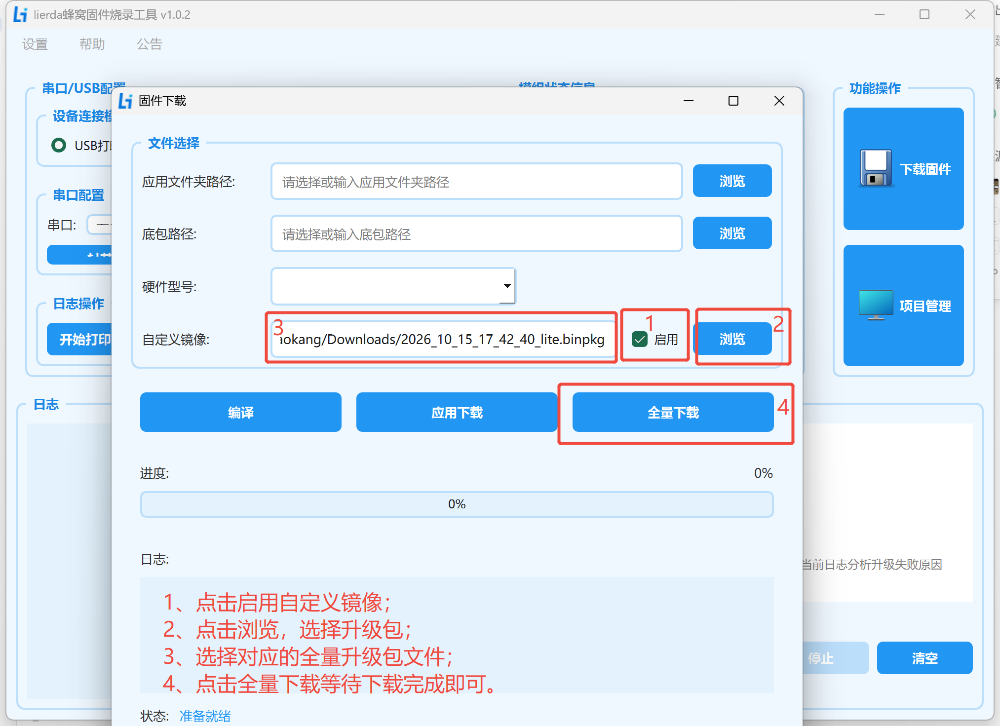
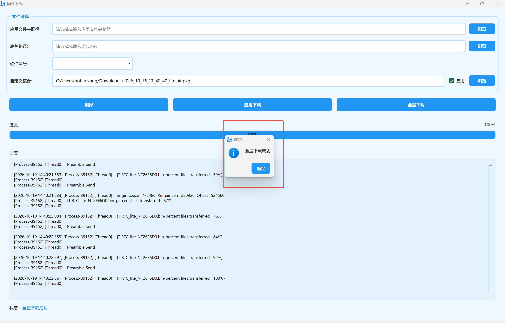

# OpenKit 固件烧录指南

## 按板型选择烧录工具

使用 USB 数据线连接设备，并关闭占用串口的工具。网页烧录可使用桌面 Chrome 或 Edge。

| 产品 | 正式入口 | 烧录方式 |
| --- | --- | --- |
| EC718PM Lite · NT26F6D0 | [打开 Lite 网页烧录](https://xiaotai.chat/web-flasher/?board=lierda-ec718pm-lite) | 适配 F6D_D。选择网页列出的版本，或导入匹配的完整 Lite `.binpkg`。全量写入可能清除绑定、设置和文件，请先保存备份。 |
| EC718PM Pro · NT26F6D0 | [PM Pro 网页烧录](https://xiaotai.chat/web-flasher/?board=lierda-ec718pm-pro) | 选择包含语音应用和外置 UI 资源的[完整 PM Pro 包](../firmware/pro/README.md)。 |
| EC718HM Pro · NT26F9D0 | [HM Pro 网页烧录](https://xiaotai.chat/web-flasher/?board=lierda-ec718hm-pro) | 选择 `F9D_D` 1.7.0 对应的[完整 HM Pro 包](../firmware/hm-pro/README.md)。网页识别为 1.7.1 时，先保存备份，再确认清除应用数据并重装。空白板或布局未知时使用原厂初始化流程。 |

打开对应板型页面，选择页面提供的固件或导入配套完整包。按页面提示连接串口，核对目标板和写入范围，再执行可用的烧录操作。使用原厂工具时，Lite 和 PM Pro 见下方图解，HM Pro 见 [HM Pro 原厂步骤](../firmware/hm-pro/README.md#flash)。

## 原厂工具备用流程

下文图解适用于 `NT26F6D0 / L-CT4IT00-YP00W-01-V04` 的 Lite 和 PM Pro。已经准备好配套 `.binpkg` 时可直接烧录。

## 1. 先选对固件

| 版本 | 选择文件与顺序 |
| --- | --- |
| Lite | 使用 [Lite 固件目录](../firmware/lite/) 中的当前 `_lite.binpkg`，全量下载一次即可。 |
| Pro | 按 [Pro 语音版构建说明](../TiRTC-EC718PM-Pro/docs/构建与固件.md)生成配套包。先全量下载资源安装包，启动并等到 `INSTALL_OK files=7`，再全量下载语音应用包。两次使用下面相同的按钮操作。 |

下载的预编译包按所在目录的 `SHA256SUMS.txt` 校验。自行构建的 Pro 包用 `Get-FileHash -Algorithm SHA256` 记录本次文件摘要。Pro 已安装完整匹配的资源，且本版说明确认资源未变化时，可以只烧录正式 `_pro_app.binpkg`；首次安装不能省略资源步骤，也不要改选历史合并包。

全量下载可能清除绑定、设置和内部文件，先备份需要保留的数据，完成后按需重新绑定。

## 2. 按图全量下载

1. **连接设备**：结束通话，关闭占用设备串口的软件，保持 USB 连接，下载时按工具提示进入下载模式；可自动进入时无需手动操作，串口号以实际识别为准。
2. **启用自定义镜像**：打开工具的“下载固件”，勾选“自定义镜像”旁的“启用”。
3. **选择固件**：点击该行“浏览”，选择上表对应的完整 `.binpkg`，核对文件名。使用完整包时，无需点击“编译”或另选底包。
4. **全量下载**：点击“全量下载”，保持供电和 USB 连接，等待进度达到 100%，并明确提示“全量下载成功”；报错时不要继续下一步。
5. **正常启动**：Lite 检查 OLED 页面并继续联网绑定；Pro 资源安装包启动后必须等 `INSTALL_OK files=7`，再关闭日志串口并重复上述操作烧正式应用包。正式应用包启动后确认 `LOAD_OK`，检查字体、背景和触摸。

图 1：启用自定义镜像 → 浏览选择固件 → 核对文件名 → 全量下载。**两图均以旧 Lite 包示意，实际文件按上表选择。**

图 2：进度达到 100%，并显示“全量下载成功”。Pro 的此提示只表示当前包下载完成，不能代替设备启动后的资源安装成功日志。

**官方详细资料（按需查阅）：** 工具下载、驱动安装及进入下载模式的方法见[利尔达完整烧录教程](https://opendocs.lierda.com/docs/CAT.1_Doc_Protal/zh_CN/tools/flash/flash-tool.html)。

产品入口 [Lite 入门](../TiRTC-EC718PM-Lite/README.md) · [PM Pro 入门](../TiRTC-EC718PM-Pro/README.md) · [HM Pro 入门](../TiRTC-EC718HM-Pro/README.md)
