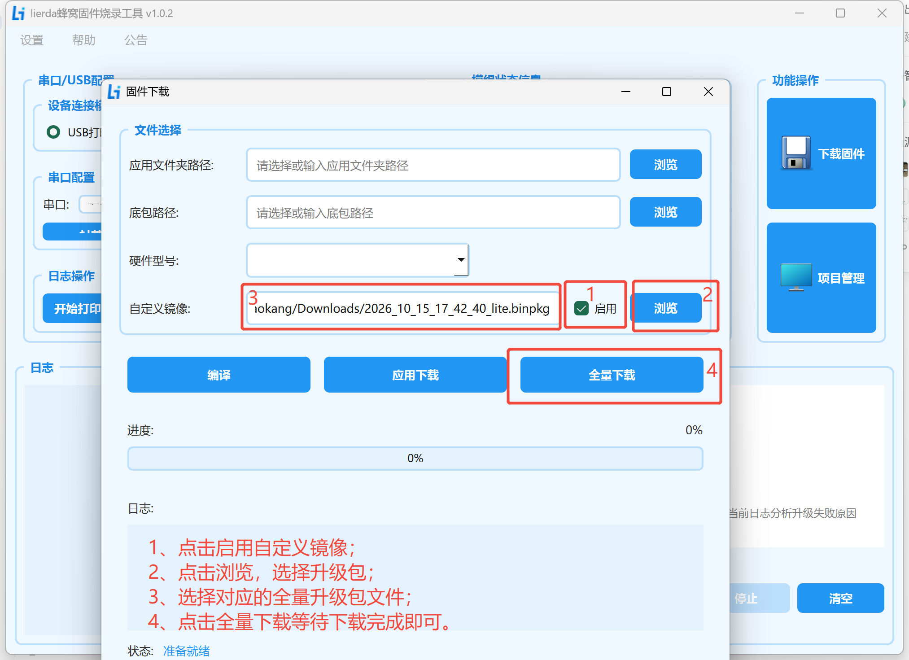
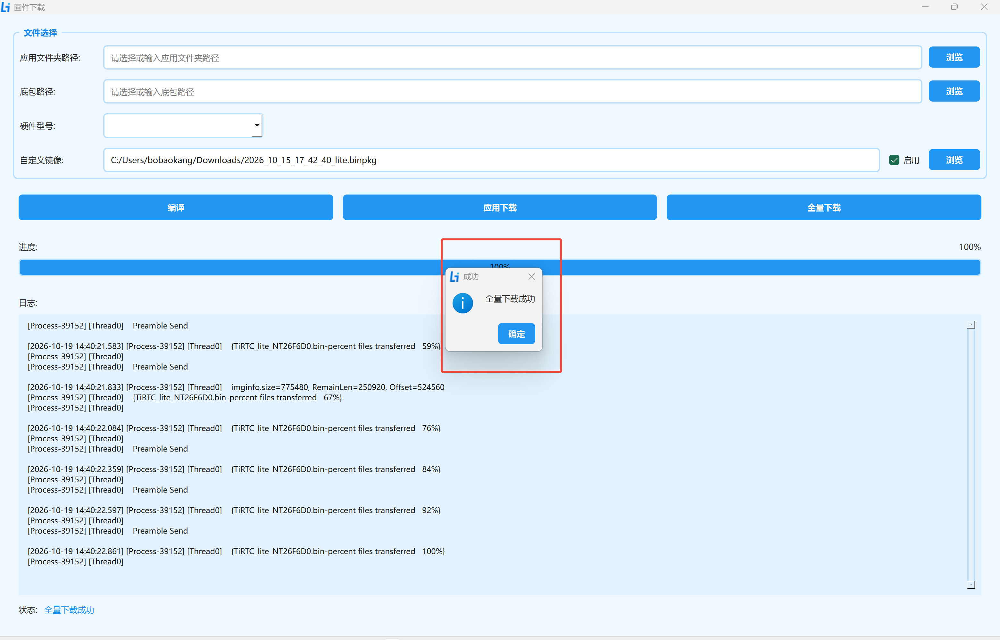

# Lite / Pro 全量烧录简明图解

适用于 `NT26F6D0 / L-CT4IT00-YP00W-01-V04`，使用利尔达蜂窝固件烧录工具。已经下载好本项目的完整 `.binpkg` 时，按下面操作即可，无需重新编译。

## 1. 先选对固件

| 版本 | 选择文件与顺序 |
| --- | --- |
| Lite | 使用 [Lite 固件目录](../../../firmware/lite/) 中的当前 `_lite.binpkg`，全量下载一次即可。 |
| Pro | 按 [Pro 配套固件说明](../../../firmware/pro/README.md)，先全量下载 `_pro_assets.binpkg`，启动并等到 `INSTALL_OK files=7`，再全量下载 `_pro_app.binpkg`。两次使用下面相同的按钮操作。 |

下载后核对各固件目录的 `SHA256SUMS.txt`。Pro 已安装完整匹配的资源，且本版说明确认资源未变化时，可以只烧录正式 `_pro_app.binpkg`；首次安装不能省略资源步骤，也不要改选历史合并包。

全量下载可能清除绑定、设置和内部文件，先备份需要保留的数据，完成后按需重新绑定。

## 2. 按图全量下载

1. **连接设备**：结束通话，关闭占用设备串口的软件，保持 USB 连接，下载时按工具提示进入下载模式；可自动进入时无需手动操作，串口号以实际识别为准。
2. **启用自定义镜像**：打开工具的“下载固件”，勾选“自定义镜像”旁的“启用”。
3. **选择固件**：点击该行“浏览”，选择上表对应的完整 `.binpkg`，核对文件名。使用完整包时，无需点击“编译”或另选底包。
4. **全量下载**：点击“全量下载”，保持供电和 USB 连接，等待进度达到 100%，并明确提示“全量下载成功”；报错时不要继续下一步。
5. **正常启动**：Lite 检查 OLED 页面并继续联网绑定；Pro 资源安装包启动后必须等 `INSTALL_OK files=7`，再关闭日志串口并重复上述操作烧正式应用包。正式应用包启动后确认 `LOAD_OK`，检查字体、背景和触摸。

图 1：启用自定义镜像 → 浏览选择固件 → 核对文件名 → 全量下载。**两图均以旧 Lite 包示意，实际文件以上表对应目录的当前包为准。**

图 2：进度达到 100%，并显示“全量下载成功”。Pro 的此提示只表示当前包下载完成，不能代替设备启动后的资源安装成功日志。

**官方详细资料（按需查阅）：** 工具下载、驱动安装及进入下载模式的方法见[利尔达完整烧录教程](https://opendocs.lierda.com/docs/CAT.1_Doc_Protal/zh_CN/tools/flash/flash-tool.html)。

返回：[Lite 入门](../tirtc_lite/README.md) · [Pro 入门](../tirtc_pro/README.md)
