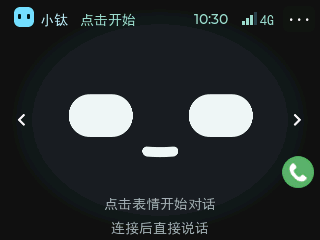
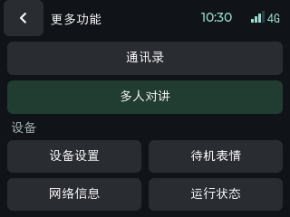

# pro · TiRTC × 利尔达 OpenKit 触屏音视频示例

[返回产品选择](../../../README.md)

用一台带屏幕、摄像头、麦克风和喇叭的 4G 设备，体验 **AI 对话、AI 呼叫联系人、微信/设备音视频电话、实时查看与远程对讲、多人对讲**。

> **首次烧录先看：[简明全量烧录图解（含两张操作截图）](../docs/全量烧录.md)**
>
> 从 [Pro 固件目录](../../../firmware/pro/README.md) 下载配套包，首次安装按“资源安装包 → `INSTALL_OK` → 正式应用包”执行。工具、驱动与官方详细教程见第 3 节，按需查阅。

本项目基于 **L-CT4IT00-YP00W-01-V04 / NT26F6D0（EC718PM）**，工程目录为 `NT26FxDx_OpenKit`，展示 TiRTC 如何接入这套 OpenKit 硬件。先按本文把设备运行起来，再沿文档读懂平台接入、媒体传输和应用代码，最后替换成自己的产品界面与业务。

<p>
  
  
</p>

图为**当前 UI 源码的离线渲染**，使用工程内的字体、图标、背景和布局，原生尺寸 320×240；时间、联系人等为示例数据。不是硬件拍照，也不代表真实连接状态。左右箭头切换表情/时钟，右上角 `···` 打开菜单。

**阅读顺序：** [认识功能](#features) → [看演示](#demo-videos) → [准备硬件](#hardware) → [简明烧录图解](../docs/全量烧录.md) → [烧录与体验](#run) → [源码接入与开发](#development)；[官方资料](#lierda-guides)按需查阅。

> 当前构建版本为 `pro_release`，使用官方 SDK 1.7.0 / `F6D_D`，默认启用 AEC 和 ANS 噪声抑制（与 Lite 相同的 `bypass=0, mode=1`），AGC 保持关闭；麦克风档位曲线与 Lite 一致，出厂默认 L8，已保存档位优先，AI 对话采用与 Lite 相同的 Opus / 16 kHz 单声道（上行 20 ms、目标 24 kbit/s），支持边播边听与插话打断。多人对讲见 [图文操作](docs/多人对讲.md#quick-start)，固件用途和构建方式见 [构建说明](docs/构建与固件.md)。

<a id="features"></a>
## 1. 先看设备能做什么

| 功能 | 从哪里操作 | 当前实现 | 演示 / 操作说明 |
| --- | --- | --- | --- |
| 联网与绑定 | 首次开机按屏幕提示 | 4G 自动联网、六位码绑定、重启恢复身份、断线恢复 | [观看演示](#video-binding) |
| AI 语音对话 | 点首页表情 | AEC 回声消除、边播边听、云端插话打断、字幕、表情/时钟切换 | [观看演示](#video-ai-talk) |
| AI 呼叫联系人 | 对 AI 说“呼叫小李” | 默认视频；明确指定语音时走音频；需配置云端设备插件 | [观看演示](#video-ai-call) |
| 微信音视频电话 | 通讯录 → 微信联系人 | 语音/视频呼出（正式版小程序，`wx_version_type=0`）、来电接听/拒绝、关麦/关摄像头、挂断 | [观看演示](#video-wechat-call) |
| 设备间音视频电话 | 通讯录 → 设备联系人 | 同步平台联系人，向另一台已绑定、在线设备发起通话 | [操作说明](docs/当前设备操作.md#device-call) |
| 实时查看与远程对讲 | 平台打开设备实时查看 | 上传摄像头/麦克风，接收远端音频；设备保持首页或时钟 | [观看演示](#video-remote-view) |
| 多人对讲 | 菜单 → 多人对讲 | 创建/加入房间、成员列表、按住讲话、退出、电话抢占恢复；固定 G.711A 窄带语音 | [观看演示](#video-group-intercom) · [完整说明](docs/多人对讲.md) |
| 声音设置与记忆 | 设置页、KEY0/KEY1 | 扬声器音量、麦克风增益下拉选项、麦克风/扬声器开关、内部 NVM 保存 | [操作说明](docs/当前设备操作.md#settings) |
| 状态查看 | 菜单 → 网络信息/运行状态 | 注册状态、无线质量、内存与存储、运行事件 | [操作说明](docs/当前设备操作.md) |

### 开始前了解这些边界

- 一次保持 **一路媒体会话**；AI、电话、实时查看、多人对讲共用连接和音视频硬件。
- **AI 普通呼叫默认视频**；首页绿色电话仍是“第一位微信联系人”的**语音快捷入口**。手动视频从通讯录选择。
- 视频电话显示远端画面，本机摄像头上传但不显示本地预览小窗。
- 实时查看由远端发起，本地菜单没有开启监控入口；设备显示查看状态，可点红色电话结束。
- 多人对讲从菜单进入，默认收听，按住才发送，讲话时仍处理下行。返回菜单暂停媒体但保留房间关系，确认“退出房间”才提交退房。电话抢占后，若进入通话前在房间页或房间表单，结束时返回房间页并同步。完整步骤、音频边界和错误码见 [多人对讲详解](docs/多人对讲.md)。
- 本例由触摸开始 AI，没有语音唤醒。默认启用 AEC，AI 回复时可直接插话，由云端判断语音与打断；麦克风开关和多人对讲按住讲话规则保持不变。

<a id="demo-videos"></a>
### 操作演示视频

新增 [多人对讲实机演示](#video-group-intercom)，可配合 [创建、加入与双端对讲步骤](docs/多人对讲.md#quick-start) 体验。

以下 7 段为真实设备录像，按首次使用的顺序排列。展开条目后，点击播放器的播放按钮即可观看；也可下载仓库中的 MP4。本页使用 GitHub 视频附件，横竖画幅均保留原比例。为适配附件大小限制，绑定、微信呼入、实时查看和多人对讲使用较小的在线播放副本，保留各自画幅、30 fps、完整时长和原音轨；下载文件独立保留。多人对讲原片为 540×960 竖屏，其余分发视频为 720p。

| 演示 | 时长 | 视频文件 |
| --- | --- | --- |
| 设备绑定与基本信息查看 | 01:29 | [观看演示](#video-binding) · [下载 MP4 · 18.4 MiB](docs/assets/videos/binding.mp4?raw=true) |
| AI 对话与字幕 | 01:53 | [观看演示](#video-ai-talk) · [下载 MP4 · 7.2 MiB](docs/assets/videos/ai-talk.mp4?raw=true) |
| 通过 AI 呼叫微信（语音演示） | 00:37 | [观看演示](#video-ai-call) · [下载 MP4 · 2.9 MiB](docs/assets/videos/ai-call-wechat.mp4?raw=true) |
| 设备呼叫微信（视频） | 00:53 | [观看演示](#video-wechat-outgoing) · [下载 MP4 · 8.9 MiB](docs/assets/videos/wechat-outgoing.mp4?raw=true) |
| 微信呼叫设备（视频） | 00:39 | [观看演示](#video-wechat-incoming) · [下载 MP4 · 10.1 MiB](docs/assets/videos/wechat-incoming.mp4?raw=true) |
| 网页与微信实时查看 | 00:55 | [观看演示](#video-remote-view) · [下载 MP4 · 11.3 MiB](docs/assets/videos/remote-view.mp4?raw=true) |
| 多人对讲：创建、加入与房间讲话 | 01:54 | [观看演示](#video-group-intercom) · [下载原始 MP4 · 17.2 MiB](docs/assets/videos/group-intercom.mp4?raw=true) |


**演示与当前版本：** 录像未注明对应固件版本；其中 AI 呼叫录像展示的是**语音电话**，当前源码普通 AI 呼叫默认视频、明确要求语音时仍可发起音频通话。录像用于了解操作，不能代替对应固件的实机验收；包用途见 [构建与固件](docs/构建与固件.md)。视频文件的画幅和 30 fps 是录制与分发格式，不是设备摄像头上传参数。

<a id="video-binding"></a>
<details open>
<summary>设备绑定与基本信息查看（01:29）</summary>

https://github.com/user-attachments/assets/eeb510ab-61ee-40d0-9867-d9554f160cd9

[下载 MP4（18.4 MiB）](docs/assets/videos/binding.mp4?raw=true)

从平台绑定到设备信息查看，先了解设备和平台的关系。操作步骤、资源准备及绑定失败检查见 [联网与绑定](docs/当前设备操作.md#binding)。

</details>

<a id="video-ai-talk"></a>
<details>
<summary>AI 对话与字幕（01:53）</summary>

https://github.com/user-attachments/assets/b1c84a00-48b7-454e-b12a-4847e43723e5

[下载 MP4（7.2 MiB）](docs/assets/videos/ai-talk.mp4?raw=true)

观察触屏设备的 AI 对话、字幕和语音回答。如何开始、结束及检查有字幕无声音，见 [AI 对话](docs/当前设备操作.md#ai)。

</details>

<a id="video-ai-call"></a>
<details>
<summary>通过 AI 呼叫微信（语音演示）（00:37）</summary>

https://github.com/user-attachments/assets/607bf11e-fa28-4e4e-87a7-d57266bc40d7

[下载 MP4（2.9 MiB）](docs/assets/videos/ai-call-wechat.mp4?raw=true)

这段录像展示 AI 把语音请求转成真实微信电话，设备画面为“语音通话”。要体验当前默认视频策略，按 [AI 角色与插件配置](docs/AI呼叫微信与设备配置详解.md) 设置，再检查真实呼叫页面和对端画面；AI 口头回复不等于已经拨号。

</details>

<a id="video-wechat-call"></a>
<a id="video-wechat-outgoing"></a>
<details>
<summary>设备呼叫微信（视频）（00:53）</summary>

https://github.com/user-attachments/assets/912e0841-aa12-449a-a149-f6b1c3f5403d

[下载 MP4（8.9 MiB）](docs/assets/videos/wechat-outgoing.mp4?raw=true)

设备作为主叫、微信接听，观察两端的视频通话。手动视频入口在通讯录，首页绿色电话仍是语音快捷入口，详见 [通讯录和音视频电话](docs/当前设备操作.md#calls)。

</details>

<a id="video-wechat-incoming"></a>
<details>
<summary>微信呼叫设备（视频）（00:39）</summary>

https://github.com/user-attachments/assets/b1a9903d-680e-439a-b8c6-a7b88af15146

[下载 MP4（10.1 MiB）](docs/assets/videos/wechat-incoming.mp4?raw=true)

微信作为主叫、设备接听，配合上一段了解呼入和呼出两个方向。接听、拒绝、关麦、关摄像头和挂断的说明见 [电话操作](docs/当前设备操作.md#calls)。

</details>

<a id="video-remote-view"></a>
<details>
<summary>网页与微信实时查看（00:55）</summary>

https://github.com/user-attachments/assets/7a21bd5b-7a95-4a19-aadb-e22c2752a642

[下载 MP4（11.3 MiB）](docs/assets/videos/remote-view.mp4?raw=true)

远端发起查看，设备上传摄像头画面；声音订阅、按住说话及结束方式见 [实时查看与远程对讲](docs/当前设备操作.md#live)。设备停在首页或时钟页，进入菜单等其他页面会结束本次查看。

</details>

<a id="video-group-intercom"></a>
<details>
<summary>多人对讲：创建、加入与房间讲话（01:54）</summary>

https://github.com/user-attachments/assets/c5d0ade8-9627-4e2a-9795-d41af390b7c8

[下载原始 MP4（17.2 MiB）](docs/assets/videos/group-intercom.mp4?raw=true)

展示 Pro 创建、加入房间、成员列表，以及与电脑端的房间语音交互，其中包含连接重试画面。按 [多人对讲图文步骤](docs/多人对讲.md#quick-start) 操作，音质和功能检查见 [验收步骤](docs/多人对讲.md#validation)。原始录像完整保留，在线播放副本只压缩画面，原音轨不重新编码。

</details>

<a id="hardware"></a>
## 2. 准备硬件与账号

| 项目 | 本示例要求 |
| --- | --- |
| 板卡/模组 | L-CT4IT00-YP00W-01-V04（工程名 `NT26FxDx_OpenKit`），NT26F6D0 / F6D_D；采购时核对带触屏、摄像头的板型 |
| 显示与触摸 | ST7789、FT6336；当前逻辑横屏 320×240 |
| 摄像头/声音 | GC032A、ES8311、麦克风、喇叭 |
| 外置资源存储 | P25Q32SH 4 MiB SPI Flash，配套字库、图标与表情资源 |
| 4G | 能上网的 SIM 卡、接好的天线、稳定供电 |
| 开发电脑 | Windows 10/11、数据 USB 线、USB 驱动、利尔达下载工具；完整工程含工具链 |
| 平台与对端 | [小钛体验平台](https://xiaotai.chat)、微信联系人授权；设备通话另需一台已绑定设备 |

本示例通过 4G 联网，不提供 Wi-Fi 配网页面。不要仅根据外观相似或同为 EC718 就混用底包、引脚和固件；板级依赖说明见 [board_compat](board_compat/README.md)。

<a id="lierda-guides"></a>
<a id="3-跟随利尔达教程准备环境"></a>
## 3. 快速烧录与官方资料

**体验本项目，先看[简明全量烧录图解](../docs/全量烧录.md)。** Pro 文件选择和烧录顺序见第 4 节；工具、驱动尚未安装，或需要了解完整用法与源码开发时，再按需查阅以下官方资料。

| 参考项 | 官方资料 | 按需了解 |
| --- | --- | --- |
| 1 | [利尔达快速体验](https://opendocs.lierda.com/docs/CAT.1_Doc_Protal/zh_CN/general/quick_run_demo.html) | 认识下载、调试串口和开发板连接 |
| 2 | [USB 驱动安装](https://opendocs.lierda.com/docs/CAT.1_Doc_Protal/zh_CN/tools/usb/USB_Driver_Installation_Guide.html) | 让电脑识别模组接口，确认实际 COM 号 |
| 3 | [SDK 快速开始](https://opendocs.lierda.com/docs/CAT.1_Doc_Protal/zh_CN/general/quick_start.html) | 工程目录、编译环境、硬件型号选择 |
| 4 | [固件下载工具说明](https://opendocs.lierda.com/docs/CAT.1_Doc_Protal/zh_CN/tools/flash/flash-tool.html) | 选择镜像、进入下载、确认成功与查看日志 |

[利尔达文档首页](https://opendocs.lierda.com/docs/CAT.1_Doc_Protal/zh_CN/) · [本仓库保留的原始 SDK 英文说明](../../../README_SDK.md) · [原始 SDK 中文说明](../../../README_ZH.md)。

**板卡应用补充：** [NT26FxDx OpenKit 应用指导（含 V04）](https://opendocs.lierda.com/docs/CAT.1_Doc_Protal/zh_CN/examples/NT26FxDx%20OpenKit/NT26FxDx%20OpenKit%20Application%20Guide_Rev0.1.html) · [OpenKit TiRTC 应用开发指导](https://opendocs.lierda.com/docs/CAT.1_Doc_Protal/zh_CN/examples/NT26FxDx%20OpenKit%20TiRTC/NT26FxDx%20OpenKit%20TiRTC%20Application%20Guide_Rev0.1.html)。原始 SDK 中的旧 V04 快速开始链接现已失效，改从这些入口查阅；原始 SDK 说明仍保留原文。官方示例的界面和业务可能与本触屏应用不同，编译选项和操作以本文为准。

官方教程中的硬件 Demo 是通用示例，本产品通过下面的 pro 脚本选择 `APP_VARIANT=pro BUILD_MODE=tirtc`。官方在线 SDK 可能继续更新，本仓库按自己的固定依赖构建，不要求先覆盖为最新公共 SDK。

<a id="run"></a>
## 4. 烧录并体验 TiRTC

### 4.1 选择固件，或从源码编译

当前使用公共官方 SDK 1.7.0 / `F6D_D`，应用位于 `examples/NT26FxDx_OpenKit/tirtc_pro`。从旧 A 底包升级时须完整烧录配套底包与 APP；编译参数和烧录步骤见 [操作说明](docs/当前设备操作.md#build-flash)。

使用官方原版工具时，从 [当前 Pro 固件目录](../../../firmware/pro/) 下载配套的 `_pro_assets.binpkg` 资源安装包和 `_pro_app.binpkg` 正式应用包，按 [两次烧录详细说明](../../../firmware/pro/README.md)操作，并核对同目录的 [SHA-256 校验清单](../../../firmware/pro/SHA256SUMS.txt)。不能使用旧 A 包更新当前 D 应用。需要从源码构建时，先按 [源码准备](../../../README.md#编译与下载)获取包含本产品目录及公共 SDK 的完整工程（仅克隆原厂 SDK 不含本产品），再完成 [Python 环境准备](docs/当前设备操作.md#python-setup)，在工程根目录执行：

```powershell
.\examples\NT26FxDx_OpenKit\tirtc_pro\build.bat
```

统一入口保留内部 `APP_VERSION=pro_release`，生成包含 D 底包、应用及外置资源镜像的 `_pro.binpkg` 合并包；该包仅适合已验证支持本板外置 Flash 写入的工具。普通正式应用包位于 `gccout/tirtc_pro/TiRTC_pro_NT26F6D0_pro_release.binpkg`，资源安装包需另运行 `build_assets.bat` 构建，两个输出对应发布目录中的 `_pro_app.binpkg` 和 `_pro_assets.binpkg`。时间取各自 `.bin` 的编译完成时间（UTC+8），不是重新命名的时间。设备日志中的版本字符串带有 SDK 前缀 `appVpro_release`。完整命令、产物来源和校验说明见 [构建与固件](docs/构建与固件.md)及 [发布目录说明](../../../firmware/pro/README.md)。

### 4.2 按顺序烧录资源安装包和正式应用包

工具按钮的最简操作见[全量烧录图解（含两张截图）](../docs/全量烧录.md)，文件选择和烧录顺序按下面执行。

1. **备份绑定、设置及需要保留的文件**；全量下载可能覆盖内部数据，不能承诺保存原设置。
2. 结束设备当前媒体会话，关闭占用串口的软件，保持 USB 连接。
3. 在下载工具中启用“自定义镜像”，先选择配套的 `_pro_assets.binpkg`，执行“全量下载”。
4. 下载成功后让设备启动，查看日志并等待 `[assets14] INSTALL_OK files=7 updated=... skipped=...`。此时没有正常业务界面是预期行为；工具“下载成功”不能代替资源安装成功。
5. 关闭日志串口，再选择配套的 `_pro_app.binpkg`，执行第二次“全量下载”。
6. 正常启动后确认 `[assets14] LOAD_OK`，检查字体、背景与触摸，再继续联网绑定。

**顺序不能反：先安装资源，后恢复正式应用。** 两次下载均写内部 Flash；第一次启动的安装程序再将七个资源文件写入外置 Flash，第二个包不携带外置文件系统镜像。安装器不会自动切换为正式应用。详细界面操作、失败处理和文件选择见 [两次烧录说明](../../../firmware/pro/README.md)；开发维护见 [资源说明](resource_store/README.md)。`F6D_D_base.binpkg` 不包含完整业务。

### 4.3 按这个顺序验收

```text
开机页面和触摸正常 → 4G 移动数据连接 → 平台绑定完成
→ AI 一问一答 → 通讯录手动视频电话 → 来电接听
→ 实时查看和对讲 → 多人对讲创建/加入及双方讲话
→ 声音设置保存 → 配置 AI 拨号
```

每一步的界面、操作、预期结果、失败检查和错误码都在 [当前设备操作](docs/当前设备操作.md)。先跑通手动通话，再配置 AI 工具，能更快判断问题出在媒体还是工具调用。

<a id="development"></a>
## 5. 从源码接入与二次开发

面向使用者的文档收敛为 **五篇**，按需逐步深入：

| 文档 | 读完可以做什么 |
| --- | --- |
| [① 当前设备操作](docs/当前设备操作.md) | 编译、烧录、绑定、按图体验；查设置记忆范围、常见故障和应用错误码 |
| [② 代码与流程详解](docs/代码与流程详解.md) | 看懂任务分工、状态机、一次通话、媒体管线和资源/性能统计 |
| [③ TiRTC 接口调用与模块流程](docs/TiRTC接口调用与模块流程.md) | 接好身份、连接、媒体、回调和回收；查流号、能力声明、SDK 错误码并移植到自己的产品 |
| [④ AI 呼叫微信与设备配置详解](docs/AI呼叫微信与设备配置详解.md) | 配置角色和 call_contact，理解默认视频、协议兼容、联系人匹配与失败返回 |
| [⑤ 多人对讲](docs/多人对讲.md) | 从房间创建/加入到 G.711A 音频、PTT、诊断和服务端接口 |

业务源码集中在 [`examples/NT26FxDx_OpenKit/tirtc_pro`](.)。从 [`user_main.c`](user_main.c) 看启动和动作分发，再按业务进入 `ai`、`calls`、`remote`、`group`；硬件采播在 `media/video/port`，SDK 生命周期在 `runtime`。

本产品与 lite 共用公共 SDK 源码和工具链，业务代码各自在独立目录内。底包与接口头文件统一来自公共官方 SDK 1.7.0 / F6D_D；`tirtc_pro/board_compat` 只保留启动、屏幕及链接适配，TiRTC 库与对应头文件在自己的 `sdk` 中。仍在使用的适配和库是构建依赖，不能当“备份”删掉；原厂 `app/demo` 保持独立。历史同步范围见 [SDK_DIFF.md](SDK_DIFF.md)。

未来可共享的是 TiRTC 连接/媒体/错误码概念及 AI 工具协议；触屏布局、GPIO、摄像头方向、存储布局、实际代码路径和默认配置属于本产品，不能直接套给另一块板。更细的复用说明见 [文档目录](docs/README.md)。

本仓库已按 `tirtc_lite / tirtc_pro` 分别维护两个产品；[双产品构建与依赖](docs/README.md#two-products) 说明目录和输出隔离方式。pro 的操作说明、视频和设置行为只适用于本产品，lite 请从 [Lite 产品首页](../tirtc_lite/README.md) 阅读对应说明。

## 参考与许可

- [TiRTC 产品文档](https://docs.tange.ai/products/tirtc/)：实时音视频产品及接入资料。
- [小钛利尔达参考工程](https://github.com/tangeai/xiaotai-lierda)：本页采用“功能—硬件—快速烧录—开发”阅读顺序，官方资料按需查阅，操作与参数以当前触屏产品源码为准。
- [小钛 ESP32 参考工程](https://github.com/tangeai/xiaotai-esp32)：UI 与产品交互参考，不能直接照搬其硬件参数。
- [设备能力协议](https://github.com/tangeai/tirtc-server-example/blob/main/thing-connect/api-reference.md)：服务端业务与能力声明参考，部署服务版本需与设备配套。
- 探鸽自有应用采用 [MIT](LICENSE)；原厂派生代码、TiRTC 预编译 SDK、第三方组件及字体保留各自许可，详见 [SDK 分发说明](sdk/README.md) 与 [应用许可范围](THIRD_PARTY_NOTICES.md)。
